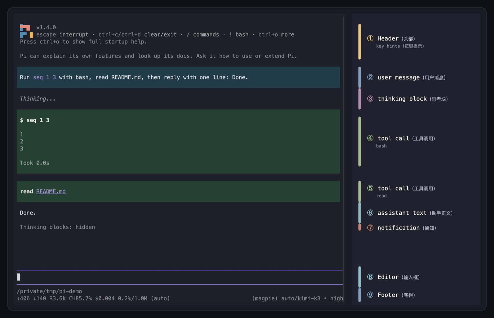

# TUI terminology

Canonical names for the Pi TUI regions in this repo. Use them in issues, PRs, docs, comments and conversation.
Every term is written as `English（中文）`: the English name is the canonical one, the Chinese name in parentheses
is its fixed equivalent. Do not invent a third name.

## For agents

When a user describes a TUI area or in-run block vaguely ("the bottom line", "that middle bit", 状态行,
快捷键栏), restate it with the canonical name before acting, e.g. "You mean the `key hints（按键提示）` in the
center of `footer（底栏）`?", and point to this document if the term matters. Never guess from a loose
description and never introduce a new name. Use these names in README, issues, PRs, code comments and test
descriptions; do not rename Pi APIs (`setFooter`, `keyHint`) or existing code identifiers (`hints`,
`FooterParts.hints`, `formatHints`).

## Canonical names

| Term | What it is | Pi API / code |
|---|---|---|
| `Header（头部）` | Startup lines at the top: version and, in native Pi, `key hints（按键提示）` | `ctx.ui.setHeader()`, `BuiltInHeader` |
| `Conversation（对话区）` | The transcript: user messages, thinking, assistant text, tool calls | `chatContainer` |
| `Working line（工作状态行）` | Spinner and status text embedded in the editor's top border | `ctx.ui.setWorkingMessage()` |
| `Editor（输入框）` | The input box you type into | `ctx.ui.setEditorComponent()`, `CustomEditor` |
| `Footer（底栏）` | The bottom line(s) of the TUI: cwd/branch, usage and model; pi-tune adds `key hints（按键提示）` in the center | `ctx.ui.setFooter()`, `FooterComponent`, `src/chrome/footer.ts` |
| `key hints（按键提示）` | Short `key + label` pairs, e.g. `/ commands · @ files · ! shell` | `keyHint()` / `rawKeyHint()` (`keybinding-hints.ts`), `src/chrome/hints.ts` |
| `Footer statuses（底栏状态行）` | Extension status entries drawn on an extra footer line | `ctx.ui.setStatus()`, `FooterParts.statuses` |

## During a run

Pi 1.4.0 with `--no-extensions` and no `-e` flags, 100×40, dark theme, after one real turn that ran `bash`
and `read README.md`. With no extensions, `key hints（按键提示）` sit in `Header（头部）` and `Footer（底栏）`
is two lines with no center segment; pi-tune replaces it with one line and moves `key hints（按键提示）`
into the center. `thinking block（思考块）` is folded (`ctrl+t`), which also adds the `notification（通知）`
line. Labels use the `English（中文）` names from the tables.

| Term | What it is | Pi API / component |
|---|---|---|
| `user message（用户消息）` | The blue-grey block holding your prompt | `UserMessageComponent` |
| `assistant message（助手消息）` | The whole record: text, thinking blocks and tool calls | `AssistantMessageComponent` |
| `assistant text（助手正文）` | The Markdown body of an assistant message | `registerMarkdownTransformer("assistant")` |
| `thinking block（思考块）` | Reasoning text; a settled block folds to `◆ Thought for 3.4s` | `registerMarkdownTransformer("assistant-thinking")`, `ctrl+t`, `hideThinkingBlock` |
| `tool call（工具调用）` | One block for an invocation plus its result | `ToolExecutionComponent`, `registerToolRenderer` |
| `tool result（工具结果）` | The result inside a tool call block | built-in tool renderers |
| `tool output（工具输出）` | The full output once a tool call is expanded | `ctrl+o`, `app.tools.expand` |
| `diff（差异）` | Added and removed rows for `edit` / `write` | `renderDiff()` |
| `shell command（shell 命令）` | A `!` command and its output | `BashExecutionComponent` |
| `notification（通知）` | One dim line appended to `conversation（对话区）` by Pi or `ctx.ui.notify()`; warning and error are variants | `showStatus()` / `showWarning()` / `showError()` |
| `compaction summary（压缩摘要）` | Summary block produced by compaction | `CompactionSummaryMessageComponent` |
| `branch summary（分支摘要）` | Summary block at a branch point | `BranchSummaryMessageComponent` |
| `steering message（插话消息）` | Queued with `enter` during a run; enters after the current turn | `steer()`, `pendingMessagesContainer` |
| `follow-up message（后续消息）` | Queued with `alt+enter`; enters after the run | `followUp()` |

pi-tune folds `tool call（工具调用）` to one line and a settled `thinking block（思考块）` to `◆ Thought for 3.4s`;
`ctrl+o` and `ctrl+t` expand them. While a run is active, `working line（工作状态行）` shows the phase in the
editor's top border.

## The three parts of `Footer（底栏）` in pi-tune

| Part | Name | Example |
|---|---|---|
| Left | `project（项目）` and `branch（分支）` | `pi-tune (main)` |
| Center | `key hints（按键提示）` | `/ commands · @ files · ! shell` |
| Right | `stats（用量统计）` | `0.0%/1.0M (auto)` |

`key hints（按键提示）` follow the editor state (`src/chrome/hints.ts`): an empty draft shows
`/ commands · @ files · ! shell`, plus `ctrl+s restore` when a draft is stashed; a draft with text shows
`@ files · ctrl+s stash`. During a run, text in the editor switches them to steer / follow-up, while an empty
editor keeps the three prefixes. A btw drawer keeps only `@ files`; a dialog-focused editor hides them. At
narrow widths `footer（底栏）` drops the center part first, then cost and cache fields.

## Names not to use

| Avoid | Use instead | Why |
|---|---|---|
| `status line` / 状态行 | `footer（底栏）` | Old wording from README and AGENTS. Pi calls the row `footer`; "status line" also collides with `Working line（工作状态行）`. |
| `status bar` | `footer（底栏）` or `footer statuses（底栏状态行）` | Pi's `setStatus()` writes one extra footer line of extension text, not the row. |
| `shortcuts` / 快捷键 | `key hints（按键提示）` | Shortcuts are the registered keybindings (`registerShortcut`, `KeybindingsManager`); the displayed `key + label` text is a key hint. |
| `commands` | `key hints（按键提示）` | `commands` is one label inside the hints, not the segment. |
| `hint bar`, `key bar`, 快捷键栏, 底部提示条 | `key hints（按键提示）` | Neither Pi nor this repo uses them. |
| `hints` alone in prose | `key hints（按键提示）` | `hints` is fine as a code identifier (`FooterParts.hints`, `formatHints`), but prose uses the full name. |
| `response` / `reply` / 回复 | `assistant text（助手正文）` | An assistant message is the record; its rendered body is text. |
| `thinking` alone / 思考 | `thinking block（思考块）` | It is a foldable block, not a phase or a stream. |
| `tool` / `tool block` | `tool call（工具调用）` | "tool" names the callable function, not the rendered block. |
| `result` / `output` alone | `tool result（工具结果）` / `tool output（工具输出）` | Say which: the result inside the block, or the expanded output. |
| `bash block` | `shell command（shell 命令）` | `!` commands are not model tool calls. |
| `toast` / `popup` | `notification（通知）` | Pi appends a line to `conversation（对话区）`; it is not a floating toast. |

## Where the names come from

- Pi: `ctx.ui.setFooter()`, `FooterComponent`, `keybinding-hints.ts` (`keyHint`, `rawKeyHint`), docs `usage.md`
  and `quickstart.md` ("footer"), `settings.md` ("key hints").
- pi-tune: `extensions/chrome.ts`, `src/chrome/footer.ts`, `src/chrome/hints.ts`, `src/shared/frame.ts`.
- In-run blocks: Pi docs `how-pi-works.md`, `json.md` (thinking block, tool call, tool results),
  `keybindings.md` (thinking blocks, tool output), and `dist/modes/interactive/components/`.
